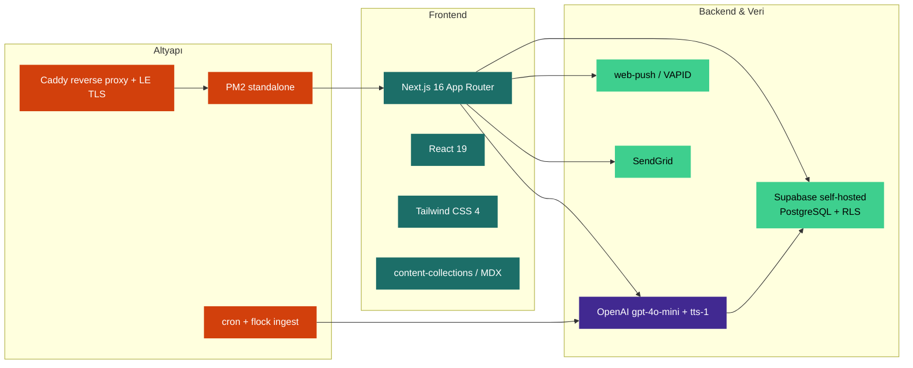
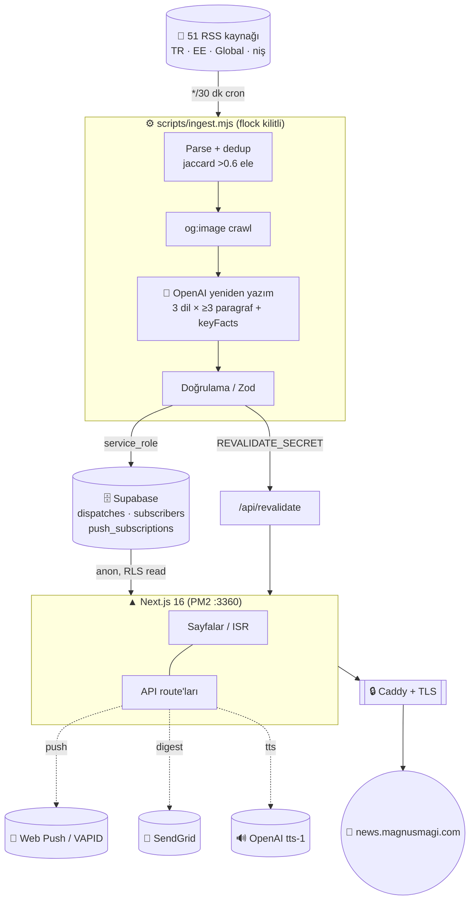
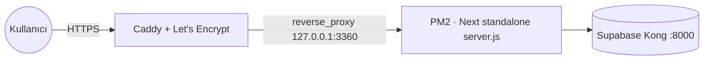

<div align="center">

# 📡 Magnus Wire

### AI‑destekli, çok dilli (🇹🇷 / 🇬🇧 / 🇪🇪) teknoloji & gündem haber teli

*RSS kaynaklarını tarar, yapay zeka ile yeniden yazar, üç dilde yayınlar — tek bir otomatik haber omurgası.*

<br/>

[](https://news.magnusmagi.com)
[](#-test--kalite)
[](#-test--kalite)
[](#-lisans)

<br/>


</div>

---

## 📑 İçindekiler

- [Genel Bakış](#-genel-bakış)
- [Öne Çıkan Özellikler](#-öne-çıkan-özellikler)
- [Teknoloji Yığını](#-teknoloji-yığını)
- [Mimari](#-mimari)
- [İçerik Akışı (Ingest Pipeline)](#-içerik-akışı-ingest-pipeline)
- [Proje Yapısı](#-proje-yapısı)
- [Rotalar](#-rotalar)
- [Veritabanı Şeması](#-veritabanı-şeması)
- [Ortam Değişkenleri](#-ortam-değişkenleri)
- [Kurulum & Çalıştırma](#-kurulum--çalıştırma)
- [Komutlar](#-komutlar)
- [Dağıtım (Deployment)](#-dağıtım-deployment)
- [Otomasyon & Cron](#-otomasyon--cron)
- [Tasarım Sistemi](#-tasarım-sistemi)
- [Çok Dillilik (i18n)](#-çok-dillilik-i18n)
- [Test & Kalite](#-test--kalite)
- [Güvenlik](#-güvenlik)
- [Yol Haritası](#-yol-haritası)
- [Lisans](#-lisans)

---

## 🌍 Genel Bakış

**Magnus Wire**, klasik bir "haber CMS"i değildir. Bir **otomasyon hattıdır**: belirlenen RSS kaynaklarını yarım saatte bir tarar, her haberi OpenAI ile **özgün, üç dilli, en az 3 paragraflık** bir yazıya dönüştürür, görselini kaynaktan crawl'lar, anahtar gerçekleri (key facts) çıkarır ve self‑hosted Supabase'e yazar. Site tarafı Next.js 16 App Router üzerinde **ISR** ile statik hızında ama taze içerikle yayınlanır.

> **Tasarım dili — "Canlı Tel / Dispatch":** Menlo monospace (makine sesi) + Fraunces serif (editör sesi) ikilisi, zaman omurgası imzası ve teal/amber iki‑renk paleti. Şablon görünümünden kaçınan, redaksiyon estetiğinde editöryel bir arayüz.

<table>
<tr>
<td>🤖 <b>Tam otomatik</b><br/>İnsan müdahalesi olmadan 7/24 içerik</td>
<td>🌐 <b>3 dil</b><br/>Türkçe, İngilizce, Estonca — eş zamanlı</td>
<td>🗺️ <b>Bölgesel kaynak</b><br/>TR kaynaklardan TR, EE kaynaklardan EE haberi</td>
</tr>
<tr>
<td>🔊 <b>Sesli dinleme</b><br/>OpenAI TTS ile her haber dinlenebilir</td>
<td>📨 <b>Bülten & Push</b><br/>E‑posta digest + web push breaking</td>
<td>🧵 <b>Gelişen hikayeler</b><br/>Aynı olayın haberleri zaman çizgisinde</td>
</tr>
</table>

---

## ✨ Öne Çıkan Özellikler

<details open>
<summary><b>İçerik & Yayın</b></summary>

| | Özellik | Açıklama |
|---|---|---|
| 📰 | **AI yeniden yazım** | Her haber `gpt-4o-mini` (JSON mode) ile 3 dilde, ≥3 paragraf + 3‑5 key fact olarak üretilir |
| 🖼️ | **Görsel crawl + proxy** | RSS'te görsel yoksa kaynak makaleden `og:image` crawl'lanır; `/api/img` ile SSRF‑korumalı proxy + hotlink aşımı |
| 🗂️ | **10 konu + 4 bölge** | Gündem, Finans, Yapay Zeka, Yazılım, Donanım, Bilim, Girişim, Kripto, Siber, Uzay × Estonya/Türkiye/Avrupa/ABD |
| 📅 | **Bugün digesti** | `/bugun` — son 24 saatin telleri, bölüme göre gruplu |
| 🧵 | **Gelişen hikayeler** | `/hikayeler` — etiket örtüşmesine göre kümeleme, her olay kronolojik timeline |
| 🔖 | **Arşiv & Arama** | `/arsiv` tüm dispatch'ler, `/ara` sanitize edilmiş sorgu + etiket filtresi |

</details>

<details open>
<summary><b>Etkileşim & Kişiselleştirme</b></summary>

| | Özellik | Açıklama |
|---|---|---|
| 🔊 | **Sesli dinle (TTS)** | `/api/tts` — OpenAI `tts-1`, MP3 diske cache'lenir, detay sayfasında "Dinle" |
| 📨 | **Bülten** | `/api/subscribe` + footer formu; `/api/newsletter/send` ile SendGrid locale‑bazlı digest |
| 🔔 | **Web push** | VAPID + Service Worker; breaking haberde bildirim; ölü abonelikler otomatik budanır |
| ➕ | **Konu takibi** | FollowButton (localStorage) → `/akis` kişisel akış (`/api/feed`) |
| 📑 | **Okuma listesi** | localStorage bookmark → `/okuma-listesi` |
| 🔗 | **Paylaş** | X / WhatsApp / Telegram / bağlantı kopyala + okuma çubuğu |

</details>

<details open>
<summary><b>UX, SEO & Performans</b></summary>

| | Özellik | Açıklama |
|---|---|---|
| 🌐 | **hreflang** | tr/en/et + `x-default` alternates, canonical |
| 🧭 | **Klavye kısayolları** | `/` arama, `t` yukarı, `j/k` önceki/sonraki haber |
| 📈 | **Görüntülenme** | `/api/view` — IP başına 30/dk rate‑limit, "En Çok Okunan" |
| 💱 | **Canlı piyasa** | /finans'ta USD/TRY, EUR/TRY, BTC, ETH şeridi |
| 🏷️ | **Trend etiketler** | `/etiketler` frekansa göre boyutlanan bulut |
| 🧱 | **JSON‑LD + OG** | NewsArticle yapısal verisi + dinamik OpenGraph görselleri |
| 🚫 | **Özel 404/error** | "Tel koptu" / "parazit" — markaya uygun hata ekranları |
| 📲 | **PWA** | manifest + ikonlar + service worker |

</details>

---

## 🧰 Teknoloji Yığını



| Katman | Teknoloji |
|---|---|
| **Framework** | Next.js `16.2.9` (App Router, `output: "standalone"`, ISR + on‑demand revalidate) |
| **UI** | React `19.2`, Tailwind CSS `4` (`@theme` token'ları, config'siz), Fraunces + Menlo (self‑host) |
| **İçerik** | content‑collections + MDX (kurumsal sayfalar), Zod şema doğrulama |
| **Veri** | `@supabase/supabase-js` → self‑hosted Supabase (Kong 127.0.0.1:8000), Row Level Security |
| **AI** | OpenAI `gpt-4o-mini` (JSON mode, yeniden yazım) + `tts-1` (sesli dinleme) |
| **Bildirim** | `web-push` (VAPID), SendGrid (e‑posta) |
| **Kaynak** | `rss-parser` (tarayıcı UA header'lı) |
| **Test** | Playwright `1.60` (9 kritik akış) |
| **Runtime** | Node `22.x`, PM2 (process `news`, port `3360`, `HOSTNAME=127.0.0.1`) |
| **Edge** | Caddy reverse proxy + Let's Encrypt wildcard TLS |

---

## 🏛️ Mimari



---

## 🔄 İçerik Akışı (Ingest Pipeline)

`scripts/ingest.mjs` her 30 dakikada bir (cron + `flock` ile tek‑örnek garantisi) çalışır:

```
RSS feed'leri (51 kaynak, her kategoriye adanmış; region/section etiketli)
        │
        ├─ 1. Parse  ........... rss-parser, tarayıcı UA header'ı
        ├─ 2. Dedup  ........... normTitle() + jaccard() benzerlik > 0.6 ise atla
        ├─ 3. Görsel ........... RSS'te yoksa kaynak makaleden og:image / twitter:image crawl
        ├─ 4. Yeniden yazım .... OpenAI gpt-4o-mini (JSON mode):
        │                          • 3 dil (tr/en/et)
        │                          • her dilde ≥3 paragraf (≥250 kelime)
        │                          • 3-5 keyFacts
        │                          • başlık, kicker, özet, etiketler
        ├─ 5. Doğrulama ........ <3 paragraf veya <3 keyFact ise throw (kalite kapısı)
        ├─ 6. Yazma  ........... Supabase upsert (service_role)
        └─ 7. Revalidate ....... POST /api/revalidate (anında tazeleme)
```

**Ayarlanabilir knob'lar (env):**

| Değişken | Varsayılan | Açıklama |
|---|---|---|
| `INGEST_MAX` | `24` | Tek koşuda işlenecek maksimum haber |
| `INGEST_KEEP` | `200` | Veritabanında tutulacak dispatch sayısı (eskiler budanır) |
| `INGEST_GUNDEM_CAP` | `5` | Gündem haberi tur-başı kotası (akışı boğmasın) |
| `INGEST_FINANS_CAP` | `5` | Finans haberi tur-başı kotası (niş kategorilere yer açar) |
| `INGEST_FEEDS` | — | Feed listesini override etmek için (opsiyonel) |

---

## 📁 Proje Yapısı

```
news-app/
├── src/
│   ├── app/
│   │   ├── [locale]/                    # i18n kök (tr/en/et)
│   │   │   ├── page.tsx                 # 🏠 Ana akış
│   │   │   ├── [slug]/page.tsx          # 🗂️ Kategori VE kurumsal sayfa (çift amaçlı)
│   │   │   ├── dispatch/[slug]/page.tsx # 📄 Haber detayı (TTS, paylaş, ilgili, JSON-LD)
│   │   │   ├── akis/page.tsx            # ➕ Kişisel akış (takip edilen konular)
│   │   │   ├── hikayeler/page.tsx       # 🧵 Gelişen hikayeler (kümeleme)
│   │   │   ├── bugun/page.tsx           # 📅 Bugün digesti
│   │   │   ├── etiketler/page.tsx       # 🏷️ Trend etiket bulutu
│   │   │   ├── kaynak/[host]/page.tsx   # 🔗 Kaynağa göre haberler
│   │   │   ├── ara/page.tsx             # 🔍 Arama
│   │   │   ├── arsiv/page.tsx           # 🗄️ Arşiv
│   │   │   ├── okuma-listesi/page.tsx   # 📑 Okuma listesi
│   │   │   └── rss.xml/route.ts         # 📡 RSS çıktısı
│   │   ├── api/
│   │   │   ├── tts/          subscribe/         feed/
│   │   │   ├── newsletter/send/   push/{subscribe,send}/
│   │   │   ├── img/          view/              revalidate/
│   │   └── news-sitemap.xml/route.ts
│   ├── components/                      # 26 bileşen (Masthead, Dispatch, AudioPlayer, ...)
│   └── lib/
│       ├── dispatches.ts                # Veri erişim katmanı (repository)
│       ├── clusters.ts                  # Story clustering algoritması
│       ├── i18n.ts                      # 3 dilli string sözlüğü
│       ├── site.ts                      # Konular, bölgeler, footer
│       ├── seo.ts                       # hreflang / SITE_URL
│       └── supabase.ts                  # anon + service_role istemcileri
├── scripts/
│   ├── ingest.mjs                       # ⚙️ RSS → AI → Supabase hattı
│   └── backfill-images.mjs              # Görsel geri doldurma
├── content/{dispatch,pages}/            # MDX kurumsal içerik
├── e2e/critical.spec.ts                 # 🎭 Playwright (9 test)
├── public/sw.js                         # 🔔 Push service worker
└── content-collections.ts
```

---

## 🛣️ Rotalar

### Sayfalar (`/[locale]/…`, locale ∈ `tr | en | et`)

| Rota | Açıklama | Render |
|---|---|---|
| `/` | Ana haber akışı | ISR |
| `/[slug]` | Kategori (konu/bölge) **veya** kurumsal MDX sayfa | ISR (`revalidate 3600`) |
| `/dispatch/[slug]` | Haber detayı | ISR |
| `/akis` | Kişisel akış (takip edilen konular) | Client |
| `/hikayeler` | Gelişen hikayeler (timeline) | ISR (`revalidate 1800`) |
| `/bugun` | Son 24 saat digesti | ISR |
| `/etiketler` · `/ara` · `/arsiv` · `/kaynak/[host]` · `/okuma-listesi` | Keşif & arşiv | ISR / Client |

### API

| Endpoint | Metot | Koruma | İşlev |
|---|---|---|---|
| `/api/tts` | GET | — | OpenAI `tts-1` → MP3 (diske cache) |
| `/api/subscribe` | POST | rate‑limit 10/dk/IP | Bülten aboneliği |
| `/api/newsletter/send` | POST | `x-newsletter-secret` | SendGrid locale digest |
| `/api/push/subscribe` | POST | — | Web push aboneliği kaydı |
| `/api/push/send` | POST | `x-newsletter-secret` | VAPID push (breaking) |
| `/api/feed` | GET | — | Takip edilen konulara göre akış |
| `/api/img` | GET | SSRF‑guard | Görsel proxy (hotlink aşımı) |
| `/api/view` | POST | rate‑limit 30/dk/IP | Görüntülenme sayacı |
| `/api/revalidate` | POST | `REVALIDATE_SECRET` | On‑demand ISR tazeleme |

---

## 🗄️ Veritabanı Şeması

Self‑hosted **Supabase / PostgreSQL**, tüm tablolarda **RLS** açık; yazma yalnızca `service_role` ile.

<details>
<summary><b><code>dispatches</code></b> — ana haber tablosu</summary>

```sql
id            uuid (pk)
slug          text
title         text
kicker        text
section       text          -- konu (gundem, finans, ...)
region        text          -- estonya | turkiye | avrupa | abd | null
summary       text
body          text
content       jsonb         -- { tr, en, et } çok dilli gövde + keyFacts
tags          text[]
hero          text          -- görsel URL
live          boolean       -- breaking / canlı
author        text
source_url    text
source_name   text
views         integer        -- increment_views() ile artar
published_at  timestamptz
created_at    timestamptz
```
</details>

<details>
<summary><b><code>subscribers</code></b> — bülten · <b><code>push_subscriptions</code></b> — web push</summary>

```sql
-- subscribers
id, email (unique), locale, active, created_at

-- push_subscriptions
id, endpoint (unique), p256dh, auth, locale, created_at
```
`increment_views(text)` → `SECURITY DEFINER`, yalnız `service_role`'a grant.
</details>

---

## 🔐 Ortam Değişkenleri

`.env.local` (asla commit edilmez — `.gitignore`'da):

```bash
# ── Supabase ───────────────────────────────
SUPABASE_URL=http://127.0.0.1:8000        # Kong (yalnız sunucu içi)
SUPABASE_ANON_KEY=...                       # RLS public read
SUPABASE_SERVICE_ROLE_KEY=...               # ingest + API yazma

# ── OpenAI ─────────────────────────────────
OPENAI_API_KEY=sk-...
OPENAI_MODEL=gpt-4o-mini

# ── ISR ────────────────────────────────────
REVALIDATE_SECRET=...

# ── Bülten (SendGrid) ──────────────────────
NEWSLETTER_SECRET=...                        # /send endpoint koruması
NEWSLETTER_FROM=news@magnusmagi.com
SENDGRID_API_KEY=SG....                       # ⚠️ ekleyene kadar /send 503 döner

# ── Web Push (VAPID) ───────────────────────
VAPID_PUBLIC_KEY=...
VAPID_PRIVATE_KEY=...
NEXT_PUBLIC_VAPID_PUBLIC_KEY=...              # istemciye açık (public)
VAPID_SUBJECT=mailto:news@magnusmagi.com
```

> 🔑 VAPID anahtarları `npx web-push generate-vapid-keys` ile üretilir.
> Yalnız `NEXT_PUBLIC_*` öneki istemci paketine girer — gerisi sunucu‑gizli.

---

## 🚀 Kurulum & Çalıştırma

```bash
# 1. Bağımlılıklar (pnpm önerilir)
pnpm install

# 2. .env.local oluştur (yukarıdaki değişkenler)
cp .env.example .env.local && $EDITOR .env.local

# 3. Geliştirme
pnpm dev                      # http://localhost:3000

# 4. İlk içerik çekimi
node scripts/ingest.mjs

# 5. Üretim derlemesi
pnpm build && pnpm start
```

> **Gereksinim:** Node 22+, erişilebilir bir Supabase örneği, OpenAI API anahtarı.
> ⚠️ pnpm 11 kullanıyorsan `sharp` için `allowBuilds` ayarına dikkat (bkz. proje notları).

---

## 🧪 Komutlar

| Komut | İşlev |
|---|---|
| `pnpm dev` | Geliştirme sunucusu |
| `pnpm build` | Üretim derlemesi (öncesinde `fetch-cache` temizlenir) |
| `pnpm start` | Üretim sunucusu |
| `pnpm lint` | ESLint |
| `pnpm test:e2e` | Playwright E2E (9 test) |
| `node scripts/ingest.mjs` | RSS → AI → Supabase çekimi |
| `node scripts/backfill-images.mjs` | Eksik görselleri geri doldur |

---

## 🌐 Dağıtım (Deployment)

**PM2 standalone + Caddy** ile self‑hosted:

```bash
pnpm build                            # standalone çıktı + postbuild (static/public kopya + .env symlink)
pm2 restart news --update-env         # process: news, port 3360
```

`postbuild` adımı kritik: `.next/standalone` içine static + public klasörlerini kopyalar ve `.env.local`'i **symlink**'ler — aksi halde standalone `server.js` env'i göremez.



---

## ⏱️ Otomasyon & Cron

```cron
# Her 30 dakikada bir, flock ile tek örnek
*/30 * * * * /usr/bin/flock -n /tmp/news-ingest.lock \
  /usr/bin/node /home/ubuntu/news-app/scripts/ingest.mjs \
  >> /home/ubuntu/news-app/logs/ingest.log 2>&1
```

**Bülten / breaking tetikleme** (cron'a eklenebilir):

```bash
curl -X POST https://news.magnusmagi.com/api/newsletter/send \
  -H "x-newsletter-secret: $NEWSLETTER_SECRET"

curl -X POST https://news.magnusmagi.com/api/push/send \
  -H "x-newsletter-secret: $NEWSLETTER_SECRET"   # payload yoksa son 'live' haberi iter
```

---

## 🎨 Tasarım Sistemi

> Felsefe: **"Canlı Tel"** — bir haber ajansının teleks makinesi ile editör masasının buluşması.

| Token | Değer | Kullanım |
|---|---|---|
| `--ink` | `#1a1916` | Ana metin / siyah |
| `--paper` | `#edebe4` | Zemin / kağıt |
| `--wire` | `#1c6e68` | Teal — vurgu (makine) |
| `--signal` | `#d2400c` | Amber/turuncu — sinyal (uyarı/aktif) |

- **Tipografi:** `Fraunces` (serif, editör sesi) × `Menlo` (mono, makine sesi) — self‑host, `font-display: swap`
- **Hareket:** yalnız compositor‑dostu özellikler (`transform`, `opacity`)
- **İmza:** zaman omurgası, dispatch numaralandırma, redaksiyon estetiği — şablon görünümü reddi

---

## 🗣️ Çok Dillilik (i18n)

- **Diller:** 🇹🇷 Türkçe (varsayılan) · 🇬🇧 İngilizce · 🇪🇪 Estonca
- **Yapı:** `app/[locale]/…` — kök layout passthrough, `html`/`body` `[locale]/layout.tsx`'te
- **Sözlük:** `src/lib/i18n.ts` (tek dosya, `t(locale, key)`); eksik anahtar → anahtar string'ine fallback
- **SEO:** her sayfada `hreflang` (tr/en/et + `x-default`) + canonical
- **İçerik:** AI üretimi 3 dilde eş zamanlı; gövde `content` jsonb'de `{ tr, en, et }`

---

## ✅ Test & Kalite

**Playwright E2E** — 9 kritik akış, canlı PM2 sunucusuna karşı:

```bash
pnpm test:e2e
```

| # | Test |
|---|---|
| 1 | Ana sayfa dispatch'lerle render olur |
| 2 | Kategori sayfası + /finans piyasa şeridi |
| 3 | Haber detayı açılır (başlık + "Dinle" + kaynak) |
| 4 | Arama sonuç **veya** boş‑durum döner |
| 5 | Arşiv sayfası yüklenir |
| 6 | Gelişen hikayeler timeline'ları |
| 7 | Kişisel akış boş‑durumu |
| 8 | Footer bülten formu görünür |
| 9 | EN & ET locale'leri doğru `lang` ile render olur |

> 🎭 `chromium-1228` cache binary'sine `executablePath` ile pinli (headless‑shell sürüm uyuşmazlığını bypass eder).

---

## 🛡️ Güvenlik

- ✅ **Secret'lar yalnız `.env.local`'de** — `.gitignore`'da, hiçbir commit'te değil (doğrulandı)
- ✅ **SSRF koruması** — `/api/img` non‑https + private IP host'ları engeller, 8s timeout, 8MB sınır
- ✅ **Rate limiting** — `/api/view` (30/dk), `/api/subscribe` (10/dk) IP başına
- ✅ **Secret‑korumalı endpoint'ler** — newsletter & push send `x-newsletter-secret` ister
- ✅ **RLS** — tüm tablolarda; istemci yalnız anon read, yazma `service_role`
- ✅ **Girdi sanitizasyonu** — arama sorgusu/etiket regex temizlik; e‑posta/host doğrulama
- ✅ **`referrerPolicy="no-referrer"`** — görsel hotlink + gizlilik

---

## 🗺️ Yol Haritası

- [ ] `SENDGRID_API_KEY` + doğrulanmış gönderici → bülten gönderimini canlıya al
- [ ] Breaking push'u ingest'e bağla (yeni `live` haberde otomatik push)
- [ ] Plausible analytics entegrasyonu (örnek hazır olunca)
- [ ] Story clustering'i embedding tabanlı benzerliğe yükselt
- [ ] Editöryel override paneli (AI çıktısını elle düzenleme)

---

## 📜 Lisans

MIT © [MagnusMagi](https://github.com/MagnusMagi) — kişisel hobi projesi.

<div align="center">
<br/>

**[🌐 news.magnusmagi.com](https://news.magnusmagi.com)** &nbsp;·&nbsp; Next.js 16 + Supabase + OpenAI ile ⚡ inşa edildi

<sub>Bu içerik yapay zeka ile üretilir; ayrıntı için her zaman kaynağa göz atın.</sub>

</div>
